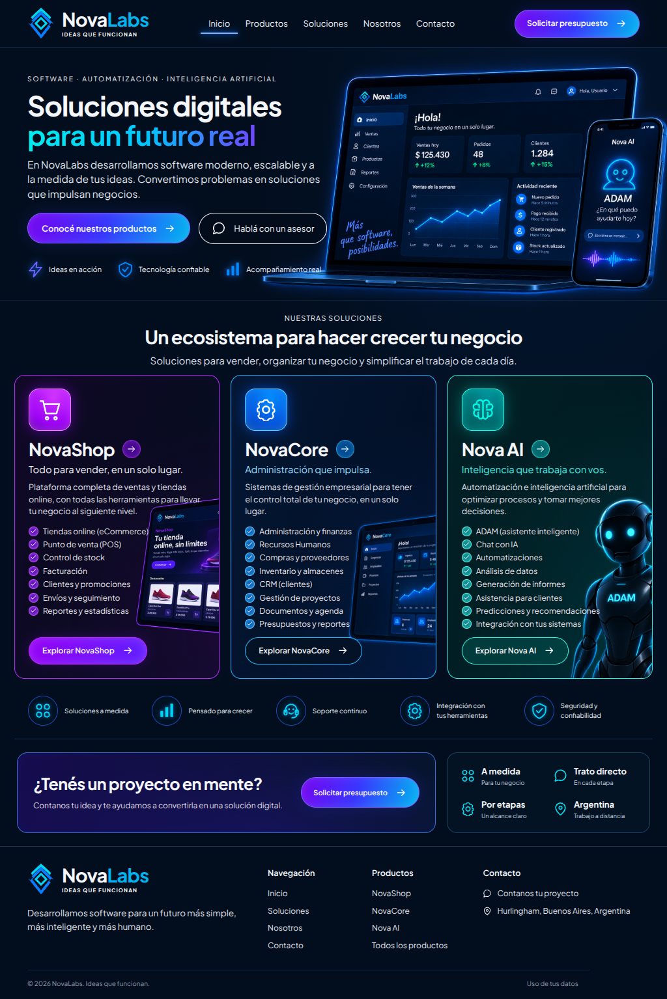

# 🚀 NovaLabs

### Soluciones digitales para un futuro más simple, inteligente y conectado.

NovaLabs es un proyecto de desarrollo web creado para presentar una agencia de soluciones digitales. Reúne una página institucional, páginas de producto y demostraciones interactivas de distintas ideas de software.

El proyecto está desarrollado con Python y Flask, junto con HTML, CSS y JavaScript.

## 🖥️ Vista previa



## ✨ Qué incluye

- Sitio web adaptable a computadoras y celulares.
- Navegación entre Inicio, Soluciones, Nosotros y Contacto.
- Páginas de presentación para tres productos.
- Demostraciones interactivas con datos ficticios.
- Diseño visual propio, tipografías locales e imágenes de producto.
- Páginas informativas y manejo de errores.

## 🧩 Productos y demostraciones

### 🛒 NovaShop
Demostración de una tienda online con catálogo, búsqueda, carrito y simulación de pedido. Los productos y precios son ficticios; no se procesan pagos ni se envían pedidos reales.

### ⚙️ NovaCore
Demostración de inventario con altas, búsqueda y ajuste de stock. Los cambios de ejemplo se guardan únicamente en el almacenamiento local del navegador; no forman un sistema multiusuario.

### 🤖 Nova AI
Recorrido guiado de ADAM, un asistente de ejemplo con opciones y respuestas predefinidas. No está conectado a un modelo de inteligencia artificial.

## 🛠️ Tecnologías

- **Python 3.11+**
- **Flask**
- **Waitress**
- **HTML5**
- **CSS3**
- **JavaScript**

## 📂 Estructura

```text
NovaLabs-Portfolio/
├── app.py
├── catalogo.py
├── requirements.txt
├── README.md
├── LEEME.txt
├── INICIAR.bat
├── static/
│   ├── css/
│   ├── fonts/
│   ├── img/
│   └── js/
├── templates/
└── tests/
```

## 🚀 Ejecutar localmente

### Requisitos
- Python 3.11 o posterior.
- Conexión a Internet para instalar las dependencias.

### 1. Clonar el repositorio

```bash
git clone https://github.com/gregoriodevey99-oss/NovaLabs-Portfolio.git
cd NovaLabs-Portfolio
```

### 2. Crear un entorno virtual

En Windows:

```powershell
python -m venv .venv
```

### 3. Instalar las dependencias

```powershell
.\.venv\Scripts\python.exe -m pip install -r requirements.txt
```

### 4. Iniciar el sitio

```powershell
.\.venv\Scripts\python.exe app.py
```

Abrí [http://127.0.0.1:5000](http://127.0.0.1:5000) en el navegador.

También podés iniciar el proyecto haciendo doble clic en `INICIAR.bat`.

## 🧪 Pruebas

```bash
python -m unittest discover -s tests -v
```

## 🔒 Alcance de esta versión pública

Este repositorio contiene únicamente la presentación pública y las demostraciones de NovaLabs. No incluye gestión de consultas ni almacenamiento de datos personales en un servidor.

NovaShop y NovaCore pueden guardar el carrito o el inventario de ejemplo en el almacenamiento local del navegador. Las demostraciones usan información ficticia. No ingreses datos personales, contraseñas ni información de pago.

## 👨‍💻 Autor

**Gregorio Devey**

Proyecto personal de desarrollo web y portfolio de programación.

---

**NovaLabs — Ideas que funcionan.**
