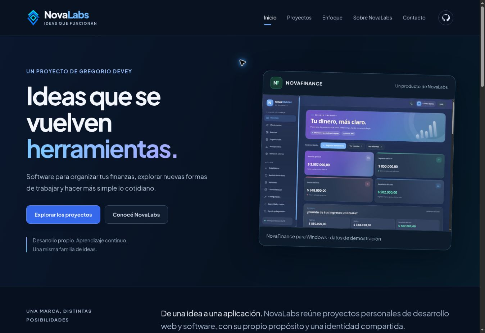
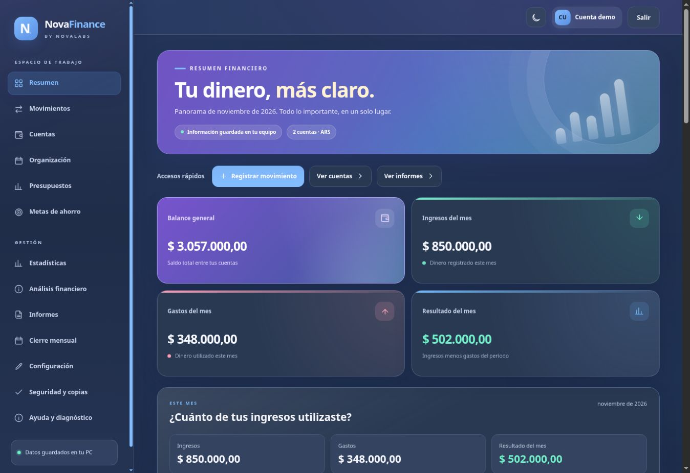
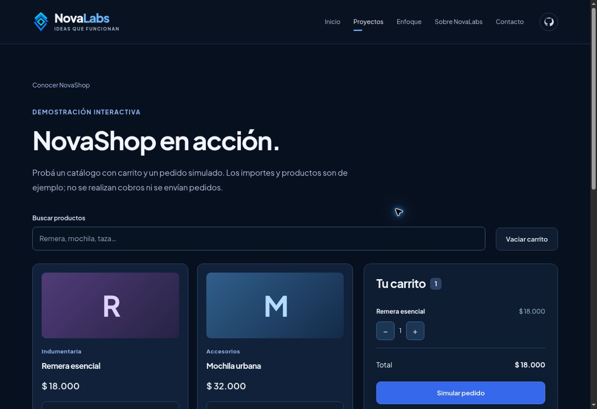
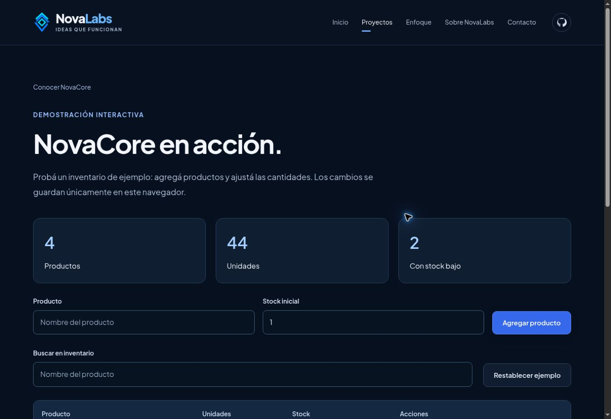
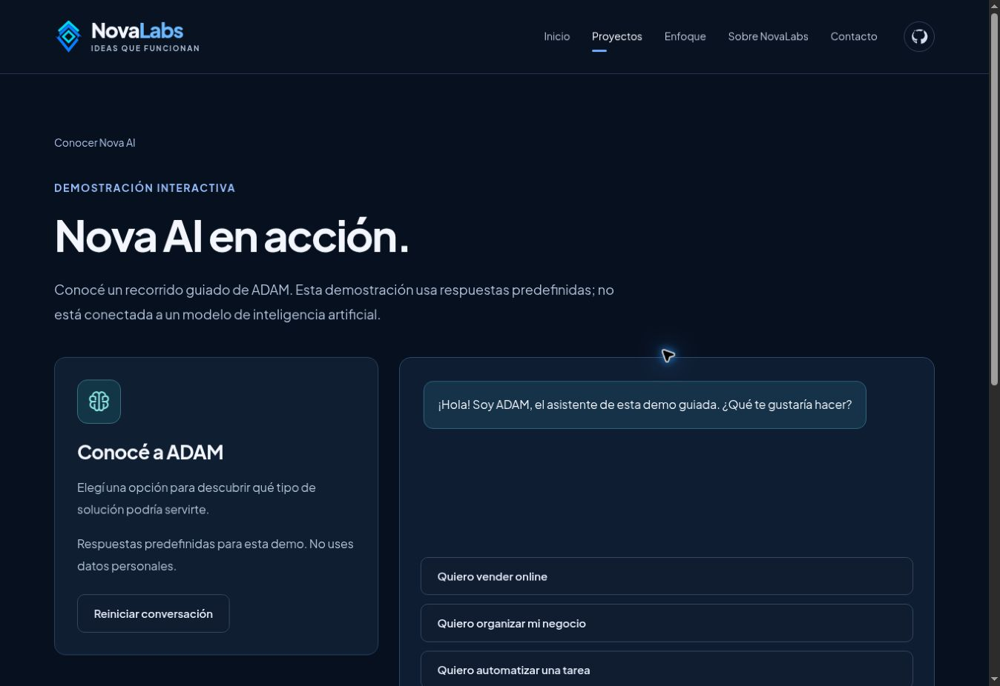

# NovaLabs · Portfolio de Gregorio Devey

**Un proyecto personal para aprender, construir y compartir software.**

Soy **Gregorio Devey**, estudiante de programación y desarrollador en formación. NovaLabs reúne mis proyectos de desarrollo web y aplicaciones: es el espacio donde convierto ideas en interfaces, practico programación y documento lo que voy construyendo.

Este repositorio contiene el **sitio público de NovaLabs**, desarrollado con **Python, Flask, HTML, CSS y JavaScript**. Incluye presentaciones de proyectos y demostraciones que se pueden explorar al ejecutar el sitio.

[Proyectos](#proyectos-del-ecosistema) · [Cómo ejecutarlo](#ejecutar-localmente) · [Caso NovaFinance](docs/novafinance.md) · [Sobre el autor](#autor)

## Vista previa



La identidad principal de NovaLabs usa tonos azules y violetas. **NovaFinance** tiene un acento verde para distinguir su propuesta de finanzas personales dentro del mismo proyecto.

## Proyectos del ecosistema

| Proyecto | Qué presenta | Estado y alcance |
| --- | --- | --- |
| **NovaFinance** | Una línea de aplicaciones para organizar las finanzas personales. | Versión Windows funcional de manera local; versión móvil en desarrollo, probada con datos de demostración en Expo Go. La publicación en la nube y la sincronización están pendientes. |
| **NovaShop** | Una tienda de ejemplo con catálogo, búsqueda, carrito y simulación de pedido. | Demostración interactiva con productos y precios ficticios. No procesa cobros ni envía pedidos reales. |
| **NovaCore** | Un inventario de ejemplo con altas, búsqueda y ajuste de stock. | Demostración interactiva. Los cambios se guardan en el navegador; no es un sistema multiusuario. |
| **Nova AI · ADAM** | Un recorrido guiado de asistente con opciones y respuestas predefinidas. | Demostración de interfaz y flujo de conversación. No está conectada a un modelo de inteligencia artificial. |

**NovaLabs es el proyecto principal; NovaFinance es uno de sus productos.** Este repositorio presenta NovaFinance y documenta su estado. El código de las aplicaciones de finanzas no está incluido aquí.

→ [Leer el caso de NovaFinance: propósito, tecnologías y próximos pasos](docs/novafinance.md)

### NovaFinance en pantalla



*NovaFinance para Windows · datos de demostración*

### Galería de demostraciones

<details>
<summary>Ver capturas de NovaShop, NovaCore y Nova AI</summary>

| NovaShop | NovaCore | Nova AI · ADAM |
| --- | --- | --- |
| [](docs/images/novashop-demo.jpg) | [](docs/images/novacore-demo.jpg) | [](docs/images/nova-ai-demo.jpg) |
| Tienda de ejemplo. Sin pagos ni pedidos reales. | Inventario de ejemplo. Los cambios se guardan en el navegador. | Recorrido con respuestas predefinidas. Sin conexión a un modelo de IA. |

Las capturas muestran las demostraciones incluidas en este portfolio. Seleccioná una imagen para verla completa.

</details>

## Qué muestra este portfolio

- **Desarrollo web con Flask:** rutas, plantillas y páginas de producto.
- **Diseño adaptable:** una experiencia pensada para escritorio y celular.
- **Interacciones con JavaScript:** catálogo, carrito, inventario y recorrido guiado.
- **Organización del proyecto:** separación entre aplicación, catálogo, plantillas y recursos estáticos.
- **Documentación del alcance:** qué funciona, qué es una demostración y qué queda por desarrollar.

## Tecnologías de este repositorio

| Parte | Tecnologías |
| --- | --- |
| Aplicación web | Python 3.11+, Flask |
| Servidor local | Waitress |
| Interfaz | HTML, CSS, JavaScript |
| Recursos | Tipografías locales e imágenes del proyecto |
| Pruebas del sitio | `unittest` |

SQLite corresponde a la aplicación local de NovaFinance; React Native y Expo, a su versión móvil. Esas tecnologías se describen en el [caso del producto](docs/novafinance.md) y no son dependencias de este sitio.

## Ejecutar localmente

Necesitás **Python 3.11 o posterior** y conexión a Internet para instalar las dependencias.

### 1. Descargar el proyecto

```bash
git clone https://github.com/gregoriodevey99-oss/NovaLabs-Portfolio.git
cd NovaLabs-Portfolio
```

### 2. Preparar el entorno e iniciar el sitio

**Windows · PowerShell**

```powershell
python -m venv .venv
.\.venv\Scripts\python.exe -m pip install -r requirements.txt
.\.venv\Scripts\python.exe app.py
```

También podés hacer doble clic en `INICIAR.bat`.

**macOS o Linux**

```bash
python3 -m venv .venv
.venv/bin/python -m pip install -r requirements.txt
.venv/bin/python app.py
```

### 3. Abrir el portfolio

Con el servidor iniciado, abrí **[http://127.0.0.1:5000](http://127.0.0.1:5000)**. Para detenerlo, presioná `Ctrl+C` en la terminal.

| Página | Ruta local |
| --- | --- |
| Inicio | `/` |
| Presentación de NovaFinance | `/productos/novafinance` |
| Presentación de NovaShop | `/productos/novashop` |
| Presentación de NovaCore | `/productos/novacore` |
| Presentación de Nova AI | `/productos/nova-ai` |
| Demostración de tienda | `/demos/novashop` |
| Demostración de inventario | `/demos/novacore` |
| Recorrido de ADAM | `/demos/nova-ai` |

La página de NovaFinance es una presentación del producto y su avance. No ejecuta la aplicación financiera de Windows ni la versión móvil.

## Estructura

| Ubicación | Contenido |
| --- | --- |
| `app.py` | Aplicación Flask y rutas. |
| `catalogo.py` | Información pública de los proyectos y configuración del sitio. |
| `templates/` | Plantillas de las páginas. |
| `static/css/` | Estilos visuales y adaptaciones de la interfaz. |
| `static/js/` | Interacciones del sitio y de las demostraciones. |
| `static/img/` | Imágenes e identidad visual. |
| `docs/` | Documentación de proyectos y casos de desarrollo. |
| `tests/` | Pruebas del sitio. |

## Pruebas

Con las dependencias instaladas, podés ejecutar las pruebas existentes.

**Windows:**

```powershell
.\.venv\Scripts\python.exe -m unittest discover -s tests -v
```

**macOS o Linux:**

```bash
.venv/bin/python -m unittest discover -s tests -v
```

## Alcance de la versión pública

El sitio es un **portfolio personal con demostraciones**. No incluye administración privada, gestión de consultas ni almacenamiento de datos personales en un servidor.

NovaShop y NovaCore pueden guardar información de ejemplo en el almacenamiento local del navegador. Las demostraciones están pensadas para datos ficticios.

El repositorio de GitHub almacena el código. Para que este sitio Flask funcione en Internet necesita un servicio compatible con Python y una configuración de despliegue. Las direcciones de esta guía son locales.

## Autor

**Gregorio Devey** · Estudiante de programación y creador de NovaLabs.

[Perfil de GitHub](https://github.com/gregoriodevey99-oss) · [LinkedIn](https://www.linkedin.com/in/gregorio-devey/)
