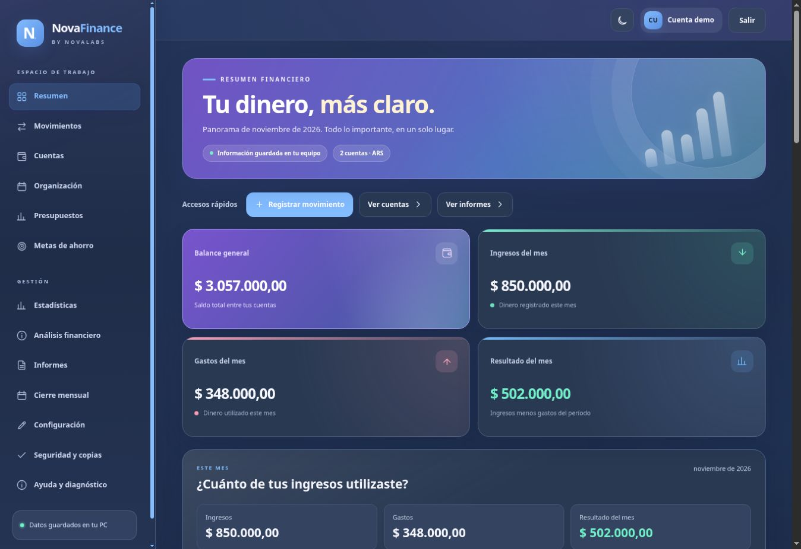
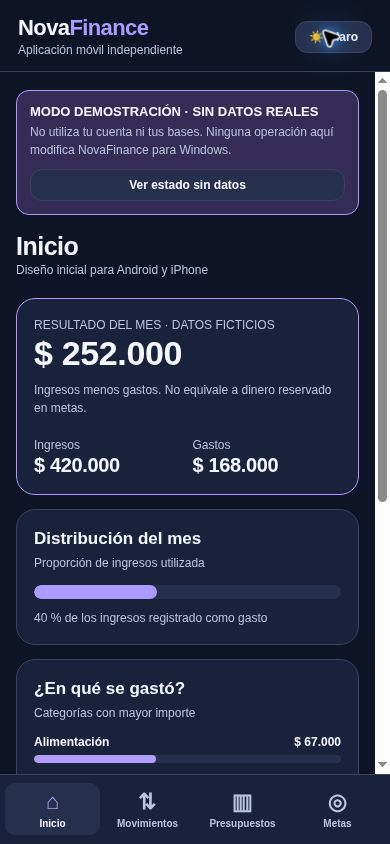

# NovaFinance · Finanzas personales dentro de NovaLabs

**Proyecto personal de Gregorio Devey · En desarrollo**

NovaFinance es una línea de aplicaciones del ecosistema **NovaLabs**. Su objetivo es ayudar a organizar las finanzas personales con una interfaz clara, tanto en la computadora como en el celular.

Este caso documenta el avance confirmado del proyecto. El repositorio público **NovaLabs-Portfolio** contiene su presentación; el código de las aplicaciones de finanzas se desarrolla por separado.

[Volver al portfolio](../README.md) · [Perfil de Gregorio](https://github.com/gregoriodevey99-oss)

## Dos versiones, un mismo propósito

| Versión | Tecnologías | Estado actual |
| --- | --- | --- |
| **NovaFinance para Windows** | Python, Flask y SQLite. | Aplicación funcional de manera local, probada por su creador. |
| **NovaFinance Móvil** | React Native y Expo. | Prototipo en desarrollo, probado en un celular mediante Expo Go con datos de demostración. |

La presentación pública usa el azul de NovaLabs y un **acento verde para NovaFinance**. Esto permite reconocer al producto y mantener su relación con el proyecto principal.

## Vista de la aplicación

*NovaFinance para Windows · datos de demostración*

## Funciones y estado actual

### Aplicación local para Windows

- Usa **Python y Flask** para la aplicación y **SQLite** para el almacenamiento local.
- Permite registrar ingresos, gastos y transferencias, organizar cuentas, definir presupuestos por categoría y seguir metas de ahorro.
- Incluye estadísticas, cierre mensual, exportación CSV y opciones de impresión.
- Funciona en la computadora y fue probada por su creador.
- Su estado actual corresponde a una aplicación local; la disponibilidad permanente en Internet es un objetivo pendiente.

### Prototipo móvil

- Está desarrollado con **React Native y Expo**.
- Fue abierto y probado en un celular con **Expo Go**.
- Incluye las secciones **Inicio, Movimientos, Presupuestos y Metas** en la experiencia de demostración.
- Tiene **modo claro y modo oscuro**.
- La información utilizada en esas pruebas es de demostración.

### Vista del prototipo móvil

*Interfaz real del prototipo renderizada con React Native Web. Datos ficticios; no es una captura de un instalador nativo.*

## Qué queda por desarrollar

| Próximo objetivo | Resultado buscado |
| --- | --- |
| Publicación de los servicios en la nube | Acceder a NovaFinance sin depender de que la computadora personal esté encendida. |
| Datos compartidos entre versiones | Poder consultar y actualizar la misma información desde Windows y el celular. |
| Sincronización | Mantener consistentes los cambios entre ambos entornos. |
| Distribución de la aplicación móvil | Contar con una versión instalable y publicada más allá de las pruebas en Expo Go. |

Estas funciones forman parte de la evolución prevista. **No están presentadas como capacidades ya disponibles.** Las pruebas con Expo Go no equivalen a una publicación en una tienda de aplicaciones.

## Decisiones de presentación

**NovaLabs reúne el trabajo; NovaFinance identifica el producto.** Esta organización permite mostrar el avance de cada aplicación sin confundir el sitio del portfolio con la herramienta financiera.

**El estado acompaña a cada versión.** Windows se presenta como una aplicación funcional local, y móvil como un prototipo en desarrollo. La publicación y la sincronización tienen su propio lugar en los próximos pasos.

**La documentación separa las tecnologías de cada parte.** Python, Flask y SQLite corresponden a la versión local; React Native y Expo, a la móvil. El sitio público está construido con Flask, HTML, CSS y JavaScript.

## Cómo explorar esta presentación

1. Seguí las [instrucciones para iniciar NovaLabs-Portfolio](../README.md#ejecutar-localmente).
2. Abrí [la página local de NovaFinance](http://127.0.0.1:5000/productos/novafinance).
3. Consultá el estado de las versiones y los próximos objetivos.

Esta página muestra el proyecto y su avance. No permite ingresar a las aplicaciones de finanzas ni consultar datos financieros reales.

## Autor y seguimiento

**Gregorio Devey** · Estudiante de programación y creador de NovaLabs.

[GitHub](https://github.com/gregoriodevey99-oss) · [LinkedIn](https://www.linkedin.com/in/gregorio-devey/)
